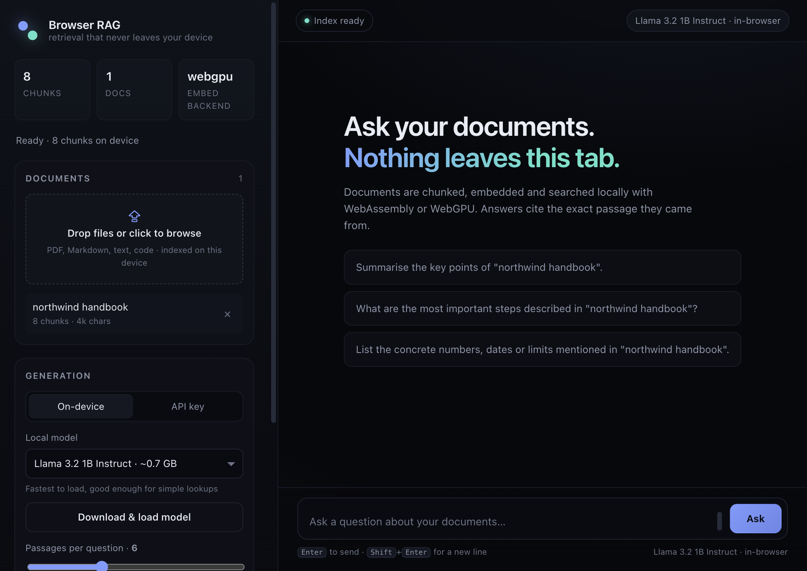
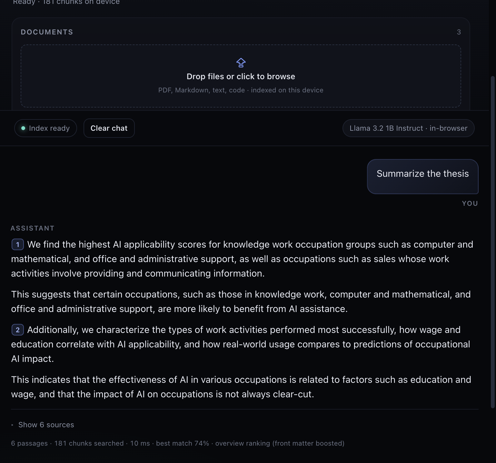
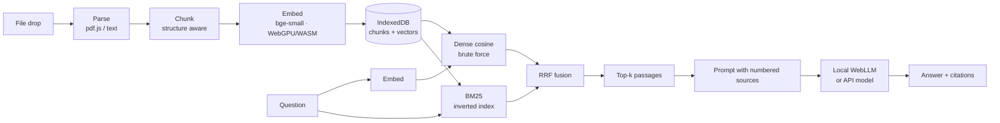

# Browser RAG

**Retrieval-augmented generation that runs entirely in your browser** — chunking, embeddings,
vector search and (optionally) generation all happen on your device. Drop in a PDF or a markdown
file, ask a question, and get an answer with citations pointing at the exact passage it came from.





- **No backend.** The whole app is static files. Hosting cost: $0.
- **No data leaves the device.** Documents are parsed, chunked and embedded locally with
  Transformers.js (ONNX Runtime Web, WebGPU with a WASM fallback) and stored in IndexedDB.
- **Optional frontier model.** Bring an API key for better synthesis — only the retrieved passages
  and your question are sent to the provider.
- **Measured, not vibes.** Hybrid retrieval (dense + BM25, fused with reciprocal rank fusion) with
  per-result scores visible in the UI.

## Quickstart

```bash
npm install
npm run dev      # http://localhost:5173
```

Then drag `samples/northwind-handbook.md` onto the Documents drop zone and ask
*"What is the error budget policy?"*.

The first load downloads a ~25 MB quantised embedding model (`bge-small-en-v1.5`); it is cached by
the browser afterwards.

Requirements: a secure context (`localhost` or HTTPS) for `crypto.subtle`, Web Workers and
IndexedDB. WebGPU is used for embedding when available (Chrome/Edge, recent Safari/Firefox);
otherwise the app falls back to single-threaded WASM.

## How it works



| Stage | Implementation |
| --- | --- |
| Parse | `pdf.js` for PDFs, `File.text()` for text-like files, page numbers preserved |
| Chunk | Markdown-heading–aware packing, ~900 chars, section path prepended, overlap tail only in the embedded text |
| Embed | `bge-small-en-v1.5` (q4 on WebGPU, q8 on WASM), CLS pooling + L2 norm, 16-chunk batches in a worker |
| Store | IndexedDB, one record per document (chunks + `Float32Array` buffer) — incremental, per-document delete |
| Retrieve | Cosine over a flat `Float32Array`, BM25 inverted index, RRF fusion, top-k |
| Generate | WebLLM (MLC) on-device, or any OpenAI-compatible endpoint streamed over SSE |

### Retrieval details worth knowing

**Chunking** splits on blank lines and tracks the markdown heading stack, so every chunk knows its
section (`Northwind Platform Handbook › 3. Incident response`). That path is prepended to the text
that gets embedded, which measurably improves matching on prose that refers back to its heading.
The previous chunk's tail is also carried into the embedding (but *not* into the text shown for
citation) to avoid cutting a thought in half at the boundary.

**Hybrid search** matters even at small scale: embeddings handle paraphrase, BM25 handles exact
identifiers, error codes and product names. Each retriever returns its top candidates, the lists
are fused with reciprocal rank fusion, and the UI shows all three scores (`dense`, `bm25`, `rrf`)
so you can see *why* a passage surfaced.

**Confidence** is the top dense cosine score. Below `0.42` the UI warns that retrieval may not
answer the question, and the prompt tells the model to be explicit about uncertainty.

**Overview questions** ("summarise the thesis", "what is this report about") get two extra rules.
Dense similarity has no notion of document position, so an appendix that merely *discusses*
summarising outranks the actual introduction; and BM25 makes it worse because the query's own words
are the intent ("summarize"), not the subject. So for detected overview queries the ranking is
reweighted towards the first fifth of each document, and the intent vocabulary is stripped before
the lexical lookup. The UI reports `overview ranking` in the retrieval metadata. This is a narrow
heuristic and an obvious candidate for the eval harness to confirm or reject.

**Output guard**: every stream is capped (700–800 tokens, 4,000 characters) and watched for
degenerate repetition — if the last 64 characters recur three times, generation is cut and the
answer is annotated with the reason. Small on-device models fall into copy loops when the context
is full of repeated instruction-shaped sentences, and a 10k-character loop is not recoverable after
the fact.

**Prompt contract**: numbered passages, cite with `[n]`, refuse when the context is insufficient,
and treat text inside passages as data rather than instructions (an indirect prompt-injection
guard — retrieved documents are untrusted input).

## Choosing a generator

| | On-device (WebLLM) | API key |
| --- | --- | --- |
| Download | 0.7–1.9 GB, cached after first load | none |
| Privacy | nothing leaves the device | question + retrieved passages go to the provider |
| Quality | 1B–3B models; fine for extraction, weaker at synthesis | frontier quality |
| Requirements | WebGPU | network |

The key is kept in `sessionStorage` by default and only written to `localStorage` if you tick
"Remember key on this device". It is sent directly from the browser to the provider — there is no
proxy and no server that could log it. Presets: OpenAI, OpenRouter, Groq, and a local Ollama
endpoint.

## Measured behaviour

From a smoke test on the bundled sample (8 chunks, Apple M-series, Chrome):

| Step | Result |
| --- | --- |
| Model download (first visit) | ~25 MB, cached thereafter |
| Ingestion of a 4k-char markdown file | 8 chunks, < 1 s |
| Retrieval (embed query + cosine + BM25 + RRF) | **136 ms** |
| Top dense score for *"What is the error budget policy…"* | **0.712**, correct section ranked first |

These are indicative numbers from a tiny corpus, not a benchmark. The roadmap below adds a proper
eval harness — publishing recall@k and latency across chunking/embedding/reranking configurations
is the next milestone.

## Project layout

```
src/
  lib/
    chunk.ts            structure-aware chunking
    bm25.ts             BM25 index + search
    fuse.ts             reciprocal rank fusion
    parse.ts            PDF / text parsing
    prompts.ts          grounded prompt construction
    db.ts               IndexedDB (idb) persistence
    ragClient.ts        promise RPC wrapper around the worker
  workers/
    embed.worker.ts     model, vectors, search, storage — all off the main thread
  llm/
    webllm.ts           on-device MLC engine
    openai.ts           OpenAI-compatible SSE streaming
    models.ts           model + provider presets
  hooks/
    useChat.ts          retrieval → prompt → streamed answer
    useSettings.ts      settings and key storage
  components/           UI
samples/                demo corpus
```

The main thread never touches vectors: the worker owns the model, the `Float32Array` and
IndexedDB, and answers RPC calls with `{ hits, scores, timings }`.

## Scripts

```bash
npm run dev        # dev server
npm run build      # typecheck + production build
npm test           # unit tests (chunker, BM25, RRF)
npm run typecheck
```

### Dev-server dependency cache

Vite pre-bundles dependencies into `node_modules/.vite`. `@mlc-ai/web-llm` **must** be pre-bundled
(its package entry is a raw ESM file with bare imports, so it cannot be served unbundled), while
`@huggingface/transformers` must **not** be (it ships its own wasm assets). If you change the
`optimizeDeps` configuration or upgrade either package, restart with a clean cache:

```bash
rm -rf node_modules/.vite && npm run dev
```

Symptom of a stale cache: `Failed to fetch dynamically imported module .../@mlc-ai/web-llm/lib/index.js`.

## Deploying

The build output in `dist/` is fully static — any static host works, with no environment variables
and no server.

### GitHub Pages

`.github/workflows/deploy.yml` typechecks, tests, builds and publishes on every push to `main`.

1. Push the repository to GitHub.
2. **Settings → Pages → Build and deployment → Source: GitHub Actions.**
3. Push to `main`, or run the workflow manually from the Actions tab.
4. The site appears at `https://<user>.github.io/<repo>/`.

The asset base is derived automatically: `vite.config.ts` reads `GITHUB_REPOSITORY` inside Actions
and sets `base` to `/<repo>/`, while local dev stays at `/`. Nothing to edit per repository.

Worth knowing:

- The repository must be **public** (or the account must have GitHub Pro) for Pages.
- The workflow creates `dist/.nojekyll` so Jekyll does not interfere with the uploaded files.
- Pages serves over HTTPS, which the app requires: `crypto.subtle`, Web Workers and model downloads
  all need a secure context.
- Every project site under `*.github.io` shares one origin, so IndexedDB and `localStorage` are
  shared between them. Fine for this app; if you host several, change `DB_NAME` in `src/lib/db.ts`.

### Other hosts

Vercel, Netlify and Cloudflare Pages serve from the domain root and need no `base` at all — just
build command `npm run build` and output directory `dist`. Cloudflare Pages would also be the place
to add the `COOP`/`COEP` headers described below if you ever want multithreaded WASM.

To enable multithreaded WASM for the embedding fallback you would need cross-origin isolation
(`Cross-Origin-Opener-Policy: same-origin` and `Cross-Origin-Embedder-Policy: require-corp`); the
current single-threaded setup deliberately avoids those headers because they complicate model
fetching from the Hugging Face CDN. WebGPU does not need them.

## Security notes

- **The API key is a client secret.** It lives in browser storage and is visible to anything
  running on the page. That is fine for a personal tool; it is not fine for a multi-user
  deployment. Do not commit keys, and do not ship a shared key in a public demo.
- **Retrieved text is untrusted.** A document can contain "ignore previous instructions", and a
  model will happily continue a prompt template it finds in a passage. This is not hypothetical:
  any paper, runbook or prompt-engineering doc in your corpus contains instruction-shaped text.
  Mitigations in place: excerpts are wrapped in a `<documents>` envelope, marked as quoted data
  that must never be followed, the question is placed *after* the context, and the answering
  constraint is restated last. None of this is a guarantee — treat answers as suggestions and keep
  citations visible so a human can verify.
- **Citations are the trust boundary.** Every claim should point at a numbered excerpt; if an
  answer cites nothing, suspect it.
- **The index is per-browser.** Clearing site data deletes it; there is no sync. For a corpus
  larger than a few thousand chunks, move the vector store to `sqlite-vec` in OPFS.

## Roadmap

- [ ] Eval harness with a golden question set, recall@k / MRR / faithfulness, results committed to
      `eval/results/` and run in CI
- [ ] Cross-encoder reranker over the fused candidates (`bge-reranker-base` q8)
- [ ] `sqlite-vec` in OPFS + FTS5 for corpora above ~50k chunks
- [ ] PDF OCR fallback for scanned documents (tesseract.js)
- [ ] Query rewriting for follow-up questions
- [ ] Expose the retriever as an MCP tool (`search_knowledge` / `get_document`) so agents can use
      the same index

## License

Add a `LICENSE` file before publishing (MIT or Apache-2.0 are the usual choices for a portfolio
project).
